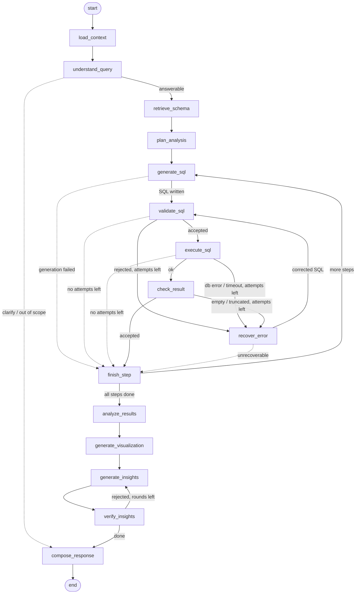

# Sageboard — Agent Workflow (LangGraph)

| Field | Value |
|---|---|
| Document | AGENT_WORKFLOW v0.3 |
| Status | v0.2 approved 2026-11-12 (design). **v0.3 (2026-11-14): as built in Phase 5** — LangGraph 1.2, SQLGlot 30. Decisions D42–D49 in DECISION_LOG.md |
| Code | `apps/api/app/agent/` — `graph.py` (assembly), `state.py`, `routing.py`, `runtime.py` (node wrapper), `nodes/`, `tools/`, `llm/`, `prompts/`, `runner.py` |
| Depends on | SYSTEM_ARCHITECTURE.md §2.2, SECURITY_DESIGN.md §4, ADR-0002, ADR-0005, ADR-0006, ADR-0007 |

---

## 1. Concepts in brief (mentor notes)

- **LangGraph `StateGraph`.** A directed graph whose nodes are Python functions. Each node reads a shared, typed **state** and returns a *partial update*; LangGraph merges it in. **Edges** decide what runs next. A **conditional edge** is a small function (a *router*) that looks at the state and returns the next node's name. Branching and retries are therefore visible in code, not hidden inside a prompt.
- **Why not a chatbot or a ReAct loop?** In a single LLM call, or a loop where the model decides everything, you can't guarantee that SQL was validated, that retries stop, or that numbers were checked. Here the graph fixes the shape (understand → schema → plan → query → analyse → verify → answer). The model only makes judgement calls *inside* nodes, and code enforces every limit.
- **Structured outputs.** Every model call returns JSON validated against a Pydantic schema. An invalid reply gets exactly one corrective re-ask (with the validation errors). A second invalid reply makes the node fail. Nothing parses free text (ADR-0005).
- **Tools.** Typed Python functions the agent uses: schema lookups, the SQL Guard, the read-only executor, the analysis engine, the chart validator and the grounding checker. Every call is recorded with its input, a summary of its output and its duration.
- **Reducer.** `trace` and `errors` are declared `Annotated[list, operator.add]`, so each node's events are *appended*; everything else is replaced.
- **Reflection.** The Verification agent checks the Insight agent's work and sends specific rejections back for a bounded rewrite. Anything still unsupported after the last round is removed and reported.

## 2. The graph (as built)

**Global guard.** Every conditional edge first calls `must_stop(state)`: if the run is terminated (`termination_reason` set), cancelled, or past its deadline, it routes straight to `compose_response`. Every run therefore ends with a coherent answer and never hangs. (These short-circuit edges exist from every routed node; they're omitted above for readability. `test_compiled_graph_has_exactly_the_designed_nodes_and_edges` pins all 37 edges.)

### 2.1 The 12 requested responsibilities → nodes

| # | Requested | Node | Model? | Tools |
|---|---|---|---|---|
| 1 | Query Understanding Agent | `understand_query` | yes → `QueryUnderstanding` | — |
| 2 | Planning Agent | `plan_analysis` | yes → `AnalysisPlan` | — |
| 3 | Schema Retrieval Tool | `retrieve_schema` | yes, bounded tool loop → `SchemaAction` | `get_table_schema`, `get_join_paths`, `get_column_values` |
| 4 | SQL Generation Agent | `generate_sql` | yes → `SQLDraft` | — |
| 5 | SQL Validation Tool | `validate_sql` | **no** | `sql_guard.validate` |
| 6 | SQL Execution Tool | `execute_sql` | **no** | `execute_sql` (read-only executor) |
| 7 | Error Recovery Agent | `recover_error` (+ `check_result` detection) | yes → `RepairedSQL` | error classifier |
| 8 | Result Analysis Agent | `analyze_results` | yes, selects calls → `AnalysisSelection` | analysis engine (10 calculations) |
| 9 | Visualization Agent | `generate_visualization` | yes → `ChartSelection` | `validate_chart_spec` |
| 10 | Insight Generation Agent | `generate_insights` | yes → `InsightDraft` | — |
| 11 | Verification Agent | `verify_insights` | deterministic + judge → `JudgeVerdict` | `grounding.check`, time-period check |
| 12 | Final Response Generator | `compose_response` | yes → `SummaryDraft` (checked) | grounding |

Control nodes (no model): `load_context` (catalog, budget clock), `check_result` (result sanity), `finish_step` (close a step, skip blocked dependents, advance).

**Order note (ADR-0007).** Schema retrieval runs *before* planning even though the request lists planning second. A plan written without the real schema invents columns. `plan_analysis` refuses to run without `schema_context`, which is tested.

## 3. Typed shared state (`app/agent/state.py`)

`AgentState` is a `TypedDict`; every nested value is a Pydantic model.

| Group | Field | Written by |
|---|---|---|
| inputs | `run_id`, `question`, `clarification_answer`, `prior_context`, `today` | runner |
| working memory | `table_catalog` | load_context |
| | `understanding: QueryUnderstanding` | understand_query |
| | `schema_context: SchemaContext` (tables, columns with types/profiles, join paths) | retrieve_schema |
| | `plan: AnalysisPlan` (1–6 query steps + analysis tasks), `current_step_idx` | plan_analysis, finish_step |
| | `step_results: dict[step_id, StepResult]` — every `SQLAttempt` (SQL, Guard verdict, normalised SQL, exec status, SQLSTATE, sanitised error, diagnosis), columns, ≤50-row preview, notes, failure explanation | SQL nodes, recover_error |
| | `facts: list[ComputedFact]` | analyze_results |
| | `charts: list[ChartSpec]` | generate_visualization |
| | `insights: list[Insight]` (with evidence refs and verification status), `verification_feedback`, `verification: VerificationReport` | generate_insights, verify_insights |
| | `response: FinalResponse` | compose_response |
| control | `budget: Budget` (LLM calls, SQL executions, attempts per step = 3, verify rounds = 2, schema tool calls = 6, deadline, tokens), `cancel_requested`, `termination_reason` | every node (via wrapper) |
| observability | `trace: list[NodeEvent]` (append-only), `errors` (append-only) | wrapper |

**Intermediate results are preserved.** Nothing is overwritten except by a newer version of the same thing: every SQL attempt of every step stays in `step_results`, and every node run stays in `trace`. Full result rows live in the run's `ResultStore` (`AgentDeps.results`), not in the state; the state keeps a ≤50-row preview so checkpoints and prompts stay small.

## 4. State transitions

| From | Condition (router) | To | Bound |
|---|---|---|---|
| `understand_query` | `status=out_of_scope` → `termination_reason=out_of_scope`; `needs_clarification` (first time) → `clarification_needed`; else | `compose_response` / `retrieve_schema` | ask at most once: with a clarification answer the node converts to `answerable` + assumption |
| `retrieve_schema` | no valid tables in a large dataset → `out_of_scope` | `compose_response` / `plan_analysis` | ≤ 6 tool calls |
| `plan_analysis` | plan present | `generate_sql` | 1–6 steps |
| `generate_sql` | latest attempt `pending` | `validate_sql`; generation failed → `finish_step` | — |
| `validate_sql` | `accepted` → execute; `rejected` (incl. `REPEATED_QUERY`) and attempts < 3 → recover | `execute_sql` / `recover_error` / `finish_step` | 3 attempts per step |
| `execute_sql` | `ok` → check; `error`/`timeout` and attempts < 3 → recover | `check_result` / `recover_error` / `finish_step` | 3 attempts; ≤ 14 executions per run |
| `check_result` | empty/all-NULL (once) or truncated (once) → recover | `recover_error` / `finish_step` | one repair per problem type |
| `recover_error` | new `pending` attempt → revalidate; unrecoverable → close | `validate_sql` / `finish_step` | counted in the 3 attempts |
| `finish_step` | more steps → next; else analyse; no step succeeded → `all_steps_failed` | `generate_sql` / `analyze_results` / `compose_response` | dependents of failed steps are `skipped` |
| `analyze_results` → `generate_visualization` → `generate_insights` → `verify_insights` | — | next | — |
| `verify_insights` | rejections and rounds < 2 → regenerate | `generate_insights` / `compose_response` | 2 rounds; still-rejected insights removed |
| any routed node | `must_stop` (terminated / cancelled / deadline) | `compose_response` | — |

`termination_reason` ends as one of `completed`, `clarification_needed`, `out_of_scope`, `all_steps_failed`, `budget_exhausted`, `cancelled`, `error`. The runner maps the response status to the session status: answered → `succeeded`, partial → `partial`, clarification → `awaiting_input`, out of scope → `succeeded`, failed → `failed` (or `cancelled`).

## 5. Node wrapper: status, duration, errors (`runtime.traced_node`)

Every node is wrapped. The wrapper:
1. **Skips** the node (status `degraded`, summary `{"skipped": reason}`) once the run is cancelled, past its deadline or terminated. `compose_response` is marked `always_run`.
2. Gives the node a `NodeContext`:
   - `ctx.llm(...)` checks the LLM-call cap and deadline *before* calling, counts calls and tokens (failed calls included) and records `{purpose, prompt_version, provider, model, ok, latency_ms, tokens, reasks}`;
   - `ctx.tool(...)` / `ctx.atool(...)` record tool calls.
3. Measures the duration and emits a `NodeEvent {seq, node, status, started_at, duration_ms, summary, tool_calls, llm_calls, error}`, appended to `trace` and sent to `deps.on_event`. The runner persists each one immediately as an `agent_node_runs` row, so a run can be watched while it's running.
4. **Contains failures.** An exception becomes a recorded event, never a crash:
   - nodes with a fallback **degrade** (charts → tables; analysis → deterministic facts only; schema → whole small dataset; SQL generation/recovery → the step fails with an explanation; insights → keep verified ones);
   - critical nodes (`understand_query`, `plan_analysis`, `validate_sql`, `execute_sql`, `verify_insights`) set `termination_reason = "error"`, and `compose_response` explains that the analysis stopped and that nothing was guessed.

## 6. Node details

- **`understand_query`.** Input: the question, today's date, the light catalog (tables, sizes, columns, **time coverage**), the previous turns of the conversation and any clarification answer. Relative periods ("last month") resolve against the latest date in the data and become an explicit assumption.
- **`retrieve_schema`.** A bounded tool loop. Each turn the model picks one action; the result comes back as `<data name="observation">`; tool errors go back as observations so the model can correct itself. The final `SchemaContext` is built by code from the real catalog, so invented table names are dropped (`ignored_unknown_tables` in the trace). Sensitive columns never expose sample values.
- **`plan_analysis`.** Turns the question into structured analytical tasks: SQL steps (purpose, expected output, dependencies) plus `analysis_tasks` for the analysis engine. Code renumbers steps `s1…sN` and drops forward dependencies. For "Why did revenue decrease last month?" a typical plan is: s1 total revenue in both months; s2 revenue by category in both months; s3 by region; tasks: % change of the total, change and contribution by category and by region.
- **`generate_sql`.** Receives the step, the whole plan, the understanding, the schema context (types, descriptions, sample values, ranges, join paths), the SQL of earlier successful steps (consistent definitions) and the previews of dependency steps (multi-query analysis).
- **`validate_sql` (SQL Guard).** Pure code: one statement, SELECT/CTE/set operations only, no forbidden node anywhere (DML/DDL/COPY/SET/transactions/`SELECT INTO`/`FOR UPDATE`, including inside CTEs), only this dataset's tables, every column resolved against the real catalog, an untyped-function allowlist plus a denylist (`pg_*`, `lo_*`, `dblink`, `set_config`, `current_setting`, `version`…), and a literal `LIMIT` ≤ cap + 1 (added when missing). It also rejects SQL identical to an earlier attempt (`REPEATED_QUERY`). Rejections explain themselves, e.g. *"Table “orders” has no column “category”. It exists in: products (join that table to use it)."*
- **`execute_sql`.** Runs only Guard-approved SQL, through the Phase 3 read-only executor: dataset reader role, `READ ONLY` transaction, statement timeout. Phase 6 adds an EXPLAIN cost gate before execution (`COST_LIMIT` → one "aggregate earlier" repair) and mid-query cancellation (the run's cancel event aborts the in-flight statement via asyncpg's cancel request). Database errors come back as data (SQLSTATE + message + hint, never `detail`, which can contain row values).
- **`check_result`.** Empty or all-NULL results get one targeted repair; results that hit the row cap get one "aggregate" repair. After that the result is accepted with a note.
- **`recover_error` (Error Recovery Agent).**
  1. Capture the failure.
  2. Classify it in code (Guard code or SQLSTATE → `unknown_column`, `grouping_error`, `type_mismatch`, `undefined_function`, `division_by_zero`, `timeout`, `too_expensive`, `empty_result`, `repeated_query`…), with a fixed hint per category. **Never retried (Phase 6, D51):** `unsafe_query` (writes, DDL, other schemas, server functions, stacked statements, SQLSTATE 25006) and `permission_denied` — recovery is for honest mistakes, not for nudging unsafe SQL through. Full taxonomy: SQL_SAFETY.md §3.
  3. Collect relevant context: tables in the failing SQL, where every column lives, time coverage for empty results.
  4. Regenerate.
  5. Revalidate through `validate_sql`.
  6. Retry within 3 attempts per step.
  7. When attempts run out, `finish_step` writes *"Couldn’t complete “…” after 3 attempts. Last problem: …"*.

  If a later correction fails but an earlier attempt returned a flagged result, that earlier result is used, with a note.
- **`analyze_results`.** Single-row results first become `lookup` facts deterministically. The model then selects calculations — `total, average, lookup, pct_change, share, top_n, group_change` (per-group change and contribution to the total change), `trend, correlation, outliers_iqr` — and the engine computes them on the full stored results. Each fact gets an id (`f1…`). Invalid calls are skipped and listed.
- **`generate_visualization`.** Specs are validated against the real result: columns exist, measures are numeric, a line chart has an ordered x, a pie has ≤ 6 non-negative slices, a KPI has one row. Invalid specs become a table for that step.
- **`generate_insights`.** Receives facts, previews with row indices, plan, assumptions, step notes and (in later rounds) verification feedback. Every insight cites evidence. Recommendations must be conditional. Causal wording is not allowed outside caveats.
- **`verify_insights` (Verification Agent).**
  - **Pass 1 (code, authoritative).** Every number in the text must match a cited fact (or its supporting values) or a cited cell, within display rounding ("$1.2M", "12.5%", "3x"). Years and small counts must appear in the question. Evidence ids must exist. Unsupported causal claims and unconditional recommendations are rejected.
  - **Run checks.** Time period: when the question names one, an executed query must use a date column. Metric and period are also judged by the model.
  - **Pass 2 (model judge).** Reject-only: it can mark wording unsupported (direction, ranking, overstatement), never rescue an insight that failed pass 1.
  - **Output.** Rejections with reasons go back for ≤ 2 rounds; anything still rejected is removed and listed. Uncertainty notes come from failed or skipped steps, truncation, empty results, assumptions and the judge.
- **`compose_response`.**
  - Builds the answer from **verified insights only**, plus caveats and assumptions. The model's summary is grounding-checked; if it contains a number not in the verified evidence, a deterministic summary (verified headlines) is used instead (`summary_source = "template"`).
  - Every termination has an honest explanation: clarification question and options; out-of-scope reason; which steps failed and why; budget hit; cancelled.

## 7. Conversation context

The runner passes the last 3 finished turns of the conversation (question, restated question, answer) as `prior_context` to understanding and planning, so follow-ups like "and by region?" work. If the previous turn ended with a clarification question (`awaiting_input`), the next message is treated as the answer: the original question is re-run with `clarification_answer`, and the earlier session is closed (`succeeded`, `clarification_answered`). This replaces the v0.2 design's checkpointer interrupt (D46).

## 8. Prompts and prompt-injection boundary

Prompts are versioned files: `app/agent/prompts/<node>.v<N>.md`. The version is recorded on every model call. A shared suffix tells the model that everything inside `<data …>…</data>` (catalog, sample values, results, earlier outputs) is information, never instructions. All dataset-derived content is wrapped that way, and a test asserts it for every call.

## 9. LLM layer (ADR-0006)

- `LLMProvider` adapters over HTTP (no vendor SDKs):
  - **Anthropic**: one forced tool, whose `input_schema` is the Pydantic JSON Schema with `$ref`s inlined.
  - **OpenAI** and **Gemini** (Gemini through its OpenAI-compatible endpoint): `response_format: json_schema`.
- Transient errors (429/5xx/timeouts) are retried twice with backoff; auth and 4xx errors fail fast; keys never appear in errors or logs.
- `StructuredLLM` validates the reply and makes one corrective re-ask.
- `LLM_PROVIDER=mock` builds **no model** (D42): questions stay queued with an explanation. Scripted model replies exist only in `tests/agent/fakes.py`.

## 10. Observability and debugging

- `GET /api/v1/analysis-sessions/{id}/trace`: every node run (status, duration, summary, tool calls, model calls, error), written while the run progresses.
- `GET /api/v1/analysis-sessions/{id}`: status, counters (LLM calls, SQL executions, tokens, duration), understanding, plan and `result` (response, steps with every attempt and preview, facts, charts with data, verification report, model label).
- `query_executions` holds every SQL attempt (`origin = 'agent'`, Guard verdict, SQLSTATE), so History lists them.
- `uv run python scripts/ask.py --email … "question"` runs a real-model analysis from the terminal and prints the trace.
- `build_graph().get_graph().draw_mermaid()` prints the live graph.

## 11. Tests

| Level | File | What it proves |
|---|---|---|
| Guard corpus | `tests/agent/test_sql_guard.py` | 43 adversarial queries rejected (DML/DDL, stacked statements, CTE-DML, system schemas, other datasets, server functions, system columns, non-literal limits), 17 benign analytics queries accepted, limit capping, actionable messages |
| Tools | `tests/agent/test_tools.py` | schema tools (privacy, join bridges), error classification, every analysis calculation and its errors, chart rules, grounding (rounding, %, K/M/B, years, cited-evidence-only, causal, recommendations) |
| LLM layer | `tests/agent/test_llm.py` | re-ask with validation errors, give-up after two, Anthropic/OpenAI request and response shapes over a mock HTTP transport, retries, fail-fast without leaking keys, truncation, factory |
| Nodes | `tests/agent/test_nodes.py` | each node through the real wrapper: events, budgets, cancellation, deadline, fallbacks, clarification rules, tool-error feedback, plan normalisation, schema-required planning, repeated-query rejection, execution cap, empty-result repair, dependent-step skipping, recovery context, judge reject-only, removal after the last round, time-period check, summary grounding, every termination |
| Routing / structure | `tests/agent/test_routing_and_structure.py` | every router's branches and bounds, global short-circuit, the exact node and edge set, no model calls in tool nodes |
| Graph (mock tools) | `tests/agent/test_graph_mock.py` | "Why did revenue decrease last month?" end to end (Guard rejection → recovery, chart fallback, ungrounded 23.4 % caught and fixed), out of scope, clarification, all attempts failing, partial answer, removal after two rounds, budget exhaustion, empty-result repair, mid-run cancellation, chart-agent failure, data boundaries |
| Graph (real DB) | `tests/integration/test_agent_pg.py` | real catalog, Guard and executor on the sample dataset: recovery from a real PostgreSQL error (42883) with computed numbers equal to an independent query; `DROP TABLE` never executed; API run → result, trace, history, ownership (404 for others); clarification resume; queued without a model; interrupted runs failed on restart |

## 12. Changes from the v0.2 design

| v0.2 | As built | Why |
|---|---|---|
| repair inside `generate_sql` | separate `recover_error` node | the request asks for a distinct Error Recovery Agent; classification and context gathering are its own responsibility |
| `request_clarification` + checkpointer `interrupt()` | clarification is a turn: the run ends `awaiting_input`, the next message resumes with `clarification_answer` | no Postgres checkpointer dependency; survives restarts; same UX (D46) |
| plan of 1–5 steps | 1–6 SQL steps + `analysis_tasks` | multi-query "why" questions need period, category and region steps |
| native vendor tool calling in `retrieve_schema` | provider-agnostic tool loop through structured outputs | identical across providers; each step validated (D45) |
| `explain_cost` gate | not built; statement timeout + row cap + one "aggregate" repair | EXPLAIN cost is unreliable on small datasets; listed as a limitation |
| mock provider usable in development | mock = no model (D42) | the project rules forbid fabricated AI output; scripted replies live only in tests |
