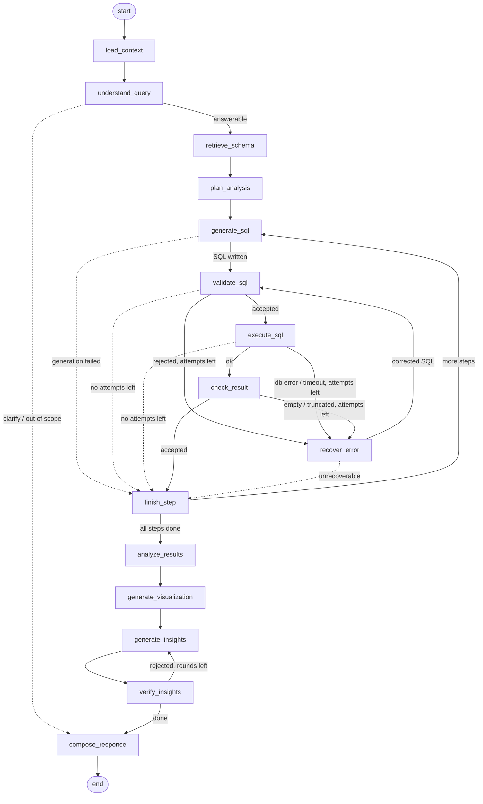

# Sageboard architecture

How Sageboard is built, as it exists in the code. Security controls are in [SECURITY.md](../security/SECURITY.md); setup, testing and decisions are in [DEVELOPMENT.md](../development/DEVELOPMENT.md).

## 1. Overview

```
Browser ── Next.js app (apps/web) ──── HTTPS, JSON, cookies ────┐
                                                                ▼
                                     FastAPI service (apps/api)
                                       routes → schemas → services
                                       agent (LangGraph) · SQL Guard · executor
                                       analysis engine · grounding verifier
                                          │ SQLAlchemy / asyncpg          │ HTTPS
                                          ▼                               ▼
                               PostgreSQL 16                        LLM provider
                               schema `app`      application data   (Gemini, Anthropic
                               schema `ds_<hex>` one per dataset     or OpenAI)
```

**Key idea:** the language model plans and writes; it never executes. It proposes a plan, SQL and wording. Deterministic code decides whether a proposal is safe, runs it with read-only database permissions, and computes the numbers. The model then explains numbers it was handed; it does not produce them.

Four database identities keep the layers apart (details in section 5): the API role only touches the `app` schema, the ingest role creates dataset schemas, the executor role can only run read-only queries under one dataset's reader role, and the owner role runs migrations.

## 2. Repository layout

```
apps/
  api/                    FastAPI backend (Python 3.12+, uv)
    app/
      main.py             create_app(): middleware, CORS, error handlers, connection pools
      core/               settings, logging (secret redaction), errors, middleware
      api/                dependencies, pagination, v1/ routers (thin: parse, call service, return schema)
      schemas/            Pydantic request/response models (the public API contract)
      services/           business logic and ownership checks (auth, datasets, analysis, history, reports, ...)
      auth/               passwords (argon2id), tokens (JWT, refresh, CSRF), cookies, rate limits
      db/                 base (UUIDv7, naming convention), models/, engines (one per role)
      ingestion/          CSV validation, type inference, identifier normalisation, upload storage, warehouse DDL/COPY
      execution/          readonly.py: the only code path that runs SQL against dataset data
      agent/              the LangGraph workflow (section 7)
      reports/            snapshot, Markdown and PDF export, fidelity check
      seed/               deterministic sample e-commerce dataset
    migrations/           Alembic, schema `app` only
    evals/                evaluation framework (see docs/eval/README.md); nothing in app/ imports it
    scripts/              ask.py (run the agent from a terminal), check_llm.py, schema_reference.py
    tests/                unit tests, tests/agent, tests/integration (real PostgreSQL)
  web/                    Next.js 16 frontend (TypeScript, Tailwind CSS 4, Recharts, pnpm)
    src/app/              routes (App Router); app/app/* is the signed-in area
    src/components/       ui primitives, charts, result table, app shell
    src/features/         one folder per page: analyst, auth, dashboard, data, history, reports, settings
    src/lib/              api client and endpoints, formatting, CSV and SQL helpers, use-api hook
    e2e/                  Playwright end-to-end tests
infra/                    local PostgreSQL setup and role bootstrap
docs/                     this documentation
.github/workflows/        CI: backend, frontend, secret scan
```

## 3. Frontend

| Route | Purpose |
|---|---|
| `/` | Landing page |
| `/login`, `/register` | Sign in, create an account |
| `/app/dashboard` | Your datasets, recent analyses and recent reports |
| `/app/analyst` | Ask questions; shows the answer, the queries and results, the findings with their evidence, and the execution timeline |
| `/app/data` | Upload a CSV, review column types, load the sample dataset, browse tables and columns, mark columns sensitive |
| `/app/history` | Past analyses (search, filter, reopen, continue, save as report) and the SQL log |
| `/app/reports`, `/app/reports/[id]` | Saved reports with PDF, Markdown and print export |
| `/app/settings` | Account details and live system status |
| `/status`, `GET /api/health` | Connectivity check and frontend liveness |

How it works:
- Pages under `/app` are client components that wait for `GET /auth/me` before rendering. Sign-in, sign-out and an expired session each trigger a full page load, so nothing from a previous session stays in memory.
- `src/lib/api/client.ts` is the only code that calls `fetch`. It sends cookies, adds the CSRF header, refreshes the session once on `TOKEN_EXPIRED`, and turns the error envelope into an `ApiError`. `endpoints.ts` has one function per endpoint; `types.ts` holds the API shapes.
- `src/lib/use-api.ts` is a small data-loading hook (loading, error, reload, ignores stale responses).
- A question starts an analysis session; the analyst page polls `GET /analysis-sessions/{id}` until the session finishes, then renders the stored result. `features/analyst/live/adapt.ts` converts the API result into the UI types in `src/types/domain.ts`.
- Charts: `ChartRenderer` maps a validated chart spec to a Recharts view. It only draws types the backend validated (`bar`, `grouped_bar`, `horizontal_bar`, `line`, `area`, `pie`, `donut`, `scatter`, `histogram`, `kpi`) and falls back to a table.
- Design tokens (colors, type scale, spacing) live in `src/app/globals.css`. Fonts: IBM Plex Sans and Mono, Source Serif 4 for headings.
- Open the app at `http://localhost:3000`, not `127.0.0.1`, so the web app and the API at `localhost:8000` count as the same site and the browser sends the sign-in cookies.

## 4. Backend

- **Routes** (`app/api/v1`) do HTTP only: parse, authenticate, call a service, return a schema.
- **Services** (`app/services`) hold business logic and transactions. Every query is filtered by the signed-in user, so another user's resource is a 404.
- **Ingestion** (`app/ingestion`) validates and parses CSV files, infers types, normalises identifiers and loads data into a new `ds_<hex>` schema with `COPY`.
- **Agent** (`app/agent`) is the LangGraph workflow in section 7. Layout: `graph.py` (StateGraph, 15 nodes), `state.py` (typed state and every structured output), `routing.py` (bounded retries, global stop), `runtime.py` (`traced_node` wrapper), `nodes/` (understanding, schema, planning, sql, recovery, analysis, visualization, insights, verification, response), `tools/` (SQL Guard, executor, schema, errors, analysis, charts, grounding), `llm/` (structured-output client, provider adapters, factory), `prompts/` (versioned `<node>.v<N>.md`), `memory.py`, and `runner.py` (load, run, persist; background task manager). `runner.py` loads a question, runs the graph as a background asyncio task, and persists every node run and SQL attempt as it happens. Runs execute in the API process (ADR-0004), so run a single API instance.
- **Reports** (`app/reports`) snapshot a finished analysis and render it as Markdown or PDF (ReportLab). A fidelity check confirms every number in a report appears in the stored results.

### Data flows

**Dataset upload.** `POST /datasets/uploads` streams the file to a private temp file, validates it, infers types and returns a review (`pending_review`). `POST /datasets/{id}/finalize` confirms the types and loads the data in one transaction: schema, reader role, table, `COPY`, grants and catalog. Any failure leaves nothing behind. `POST /datasets/demo` loads the sample dataset into your own schema.

**Question.** `POST /conversations/{id}/sessions` creates a session and starts the agent in the background. The client polls `GET /analysis-sessions/{id}` (status, counters and, when finished, the result) and can read `GET /analysis-sessions/{id}/trace`. `POST /analysis-sessions/{id}/cancel` stops it, including an in-flight query.

## 5. Database

### Layout

| Schema | Holds | Managed by | Who can read it |
|---|---|---|---|
| `app` | Product metadata: users, connections, datasets and their catalog, conversations, messages, analysis sessions, query executions, reports | Alembic (`sageboard_owner`) | `sageboard_app` (DML only) |
| `ds_<32 hex>` | One schema per dataset: the user's actual tables | Ingestion service at runtime (`sageboard_ingest`) | Only that dataset's reader role `ds_<hex>_r` |

Conventions (as built):
- Primary keys are `uuid` **v7**, generated in the app (`app/db/base.py: uuid7`), so they're time-ordered and index-friendly.
- `created_at` / `updated_at` are `timestamptz NOT NULL DEFAULT now()`; `updated_at` is also set by the ORM on update.
- Enumerations are `varchar` + `CHECK` constraints (cheaper to migrate than native enums).
- Constraint and index names follow one convention (`pk_`, `fk_`, `uq_`, `ck_`, `ix_`), so migrations and error messages are predictable.
- No soft deletes. Deletes are hard and cascade (privacy, FR-U3). Dataset deletion also drops its warehouse schema and role.
- `jsonb` for structured payloads (column profiles, ingestion issues, report content).

### Connections and roles

| Setting | Role | Driver | Used for | Can it read dataset rows? |
|---|---|---|---|---|
| `DATABASE_URL` | `sageboard_app` | SQLAlchemy async (asyncpg) | All `app` metadata reads/writes | No — `permission denied` (tested) |
| `MIGRATION_DATABASE_URL` | `sageboard_owner` | Alembic | Schema migrations only (Neon: **direct** endpoint) | Not granted |
| `INGEST_DATABASE_URL` | `sageboard_ingest` | asyncpg pool (max 3) | `CREATE SCHEMA`, `CREATE ROLE ds_…_r`, `COPY`, catalog inspection/profiling | Owns what it creates; never runs user or agent SQL |
| `EXECUTOR_DATABASE_URL` | `sageboard_executor` | asyncpg pool (max 5) | Previews and validated agent SQL | Only via `SET LOCAL ROLE ds_<hex>_r` inside a `READ ONLY` transaction |

Every executor query runs as:

```sql
BEGIN ISOLATION LEVEL REPEATABLE READ READ ONLY;
SET LOCAL ROLE ds_<hex>_r;                 -- privileges of this one dataset only
SET LOCAL search_path = ds_<hex>;
SET LOCAL statement_timeout = <ms>;        -- default 10 000
<prepared statement with bind parameters>;
COMMIT;
```

The executor role itself is `NOINHERIT` and `default_transaction_read_only = on`, so it has no privileges until it switches role. The integration tests prove each of these by having PostgreSQL refuse: writes (`ReadOnlySQLTransactionError`), other schemas (`InsufficientPrivilegeError`) and long queries (`QueryCanceledError`).

All pools use `statement_cache_size=0`, which is required behind Neon's transaction-mode PgBouncer and harmless on a direct connection. Credentials live only in backend environment variables. No API response includes a DSN, host or secret (`ConnectionOut` exposes id, name, kind, status, created_at).


### Entities

```
users 1─┬─* refresh_tokens   (CASCADE; only SHA-256 hashes)     audit_log ─0..1→ users (SET NULL)
        ├─* database_connections 1─* datasets   (connection FK: NO ACTION, deferred)
        ├─* datasets 1─┬─* dataset_tables 1─* dataset_columns
        │              ├─* dataset_relationships (from/to dataset_tables)
        │              └─* ingestion_jobs
        ├─* conversations 1─┬─* messages ─0..1→ analysis_sessions (SET NULL)
        │   (dataset_id)    └─* analysis_sessions 1─┬─* query_executions (every SQL attempt)
        │                                           └─* agent_node_runs  (one row per node run)
        ├─* query_executions   (dataset_id; analysis_session_id nullable for previews)
        └─* reports            (analysis_session_id, dataset_id: SET NULL — reports outlive both)
```

Deletion behaviour (all verified in `tests/integration/test_models.py`):
- **Delete a user** → everything they own goes (connections, datasets, catalog, conversations, messages, sessions, executions, reports).
- **Delete a dataset** → its catalog, ingestion jobs, conversations, sessions and executions go. Reports stay, with `dataset_id = NULL`.
- **Delete a connection that still has datasets** → refused (`fk_datasets_connection_id_database_connections`). The check is deferred to commit so a user deletion can cascade through both paths in one statement (migration 0003).

### Dataset schemas (`ds_<hex>`)

Lifecycle (`app/ingestion/warehouse.py`, all in **one** ingest transaction — PostgreSQL DDL is transactional, so a failure leaves nothing behind):

```sql
CREATE SCHEMA "ds_<hex>";
REVOKE ALL ON SCHEMA "ds_<hex>" FROM PUBLIC;
CREATE ROLE "ds_<hex>_r" NOLOGIN NOINHERIT;
CREATE TABLE "ds_<hex>"."<table>" (...);          -- PK if declared, else _row_id identity
COPY ... (asyncpg copy_records_to_table, 5 000-row batches)
-- demo only: ALTER TABLE ... ADD CONSTRAINT fk_<table>_<col> FOREIGN KEY ...; CREATE INDEX ix_<table>_<col> ...; ANALYZE
GRANT USAGE ON SCHEMA "ds_<hex>" TO "ds_<hex>_r";
GRANT SELECT ON ALL TABLES IN SCHEMA "ds_<hex>" TO "ds_<hex>_r";
GRANT "ds_<hex>_r" TO sageboard_executor;          -- PG16: CREATEROLE grants ADMIN on roles it created
```

- **Names.** Uploaded headers go through `normalize_identifier`: ASCII snake_case, camelCase split, `ß→ss`, accents stripped, `c_` prefix for a leading digit, `_col` suffix for reserved words, ≤ 63 bytes. Names that collide after normalisation are **rejected** with a message naming both headers (no silent `_2` suffixes). The original header is kept as `display_name`.
- **Surrogate key.** Uploaded tables without a primary key get `_row_id bigint GENERATED ALWAYS AS IDENTITY PRIMARY KEY`. It gives previews a stable order and later gives evidence a row reference, and it is hidden from the catalog and the agent.
- **Identifier safety.** Schema, table, column and role names are validated against `^[a-z_][a-z0-9_]{0,62}$` (and the `ds_` patterns) and then double-quoted (`app/db/identifiers.py`). Values are never interpolated: they go through bind parameters or COPY.
- **Deletion.** `DROP SCHEMA … CASCADE; DROP ROLE …` in a transaction, then the metadata row. Tests assert that the schema and role are gone.

### Sample dataset (“E-commerce demo”)

Generated by `app/seed/ecommerce.py` (deterministic, seed `20261113`), loaded by `uv run python -m app.seed` (`--scale small|standard`, `--replace`, `--csv-out DIR`).

| Table | Standard scale rows | Key columns |
|---|---|---|
| customers | 3 000 | customer_id PK; region, segment, signup_date; first_name/last_name/email (**sensitive**) |
| products | 160 | product_id PK; sku, category, unit_price, is_active, launched_on |
| orders | 26 082 | order_id PK; customer_id → customers; order_date (timestamptz), status, channel, shipping_fee |
| order_items | 48 141 | order_item_id PK; order_id → orders; product_id → products; quantity, unit_price, discount |
| payments | 27 833 | payment_id PK; order_id → orders; method, status (captured/failed/voided/refunded), amount, paid_at |

The window is Nov 2024 – Oct 2026, across six US regions and six categories. Built-in, documented patterns give later evaluation known answers: seasonality, a Midwest slowdown from Q3 2026, channel and segment mixes, refunds and failed payments. There is deliberately **no cost/margin data**, so the agent must say it can't compute profit. Real FKs and indexes are created, so the catalog reports declared relationships.

### Schema catalog (metadata for SQL generation)

`app/services/catalog.py` rebuilds the catalog from the **live** PostgreSQL catalog after every load. It never trusts the CSV header alone.

| Recorded | Where | Notes |
|---|---|---|
| Tables, row counts, descriptions | `dataset_tables` | Exact counts after load |
| Columns, ordinal, type, nullability, PK flag | `dataset_columns` | `inferred_type` kept when the user overrode it |
| Primary keys | `dataset_tables.primary_key` (jsonb list) | From `pg_constraint` |
| Foreign keys / relationships | `dataset_relationships` (`origin = declared`) | From `pg_constraint` |
| Semantic role | `dataset_columns.semantic_role` | identifier / measure / dimension / time / currency (heuristic, editable later) |
| Profile | `dataset_columns.profile` | null %, distinct count, min/max, top values (≤ 10 when ≤ 50 distinct) or 5 examples |
| Sensitivity | `dataset_columns.is_sensitive` | By name (email, phone, names, address, IDs, …) or by value shape (all e-mail addresses). **Sensitive columns get counts only — no samples, no min/max.** Owners can toggle it (PATCH). Turning it on erases stored samples |

`GET /datasets/{id}/schema` serves it at two levels. `summary` gives tables, descriptions and counts, for the understanding step (ADR-0007). `full` gives columns, types, keys, FKs, relationships and privacy-controlled samples, for SQL generation. `include_samples=false` strips all values.

### Migrations

Alembic manages the `app` schema only (`migrations/versions/`, version table `app.alembic_version`); `ds_%` schemas are excluded by `include_object`. Revisions: 0001 baseline, 0002 application tables, 0003 deferred connection foreign key, 0004 refresh tokens and audit log, 0005 agent node runs and session result, 0006 conversation memory. Tests run `downgrade base` then `upgrade head` and `alembic check` (models equal migrations) against a dedicated `sageboard_test` database.

For the full column-level reference run `uv run python scripts/schema_reference.py` in `apps/api`; it is generated from the SQLAlchemy models, so it cannot drift.

## 6. API

The contract is the live OpenAPI document: `GET /api/v1/openapi.json`, with Swagger UI at `/api/v1/docs` (disabled when `ENV=production`). A test fails if an endpoint is undocumented or an authenticated endpoint does not document 401. Everything is under `/api/v1`; the version changes only for breaking changes.

| Method | Path | Purpose |
|---|---|---|
| GET | `/healthz`, `/readyz` | Liveness; readiness (app, ingest and executor connections, migration head, LLM config) |
| POST | `/auth/register`, `/auth/login`, `/auth/refresh`, `/auth/logout` | Create an account, sign in, rotate the refresh token, sign out |
| GET | `/auth/me` | The signed-in user |
| GET, POST | `/datasets`, `/datasets/uploads`, `/datasets/demo` | List; upload a CSV for review; load the sample dataset |
| POST | `/datasets/{id}/finalize` | Confirm column types and load |
| GET, PATCH, DELETE | `/datasets/{id}` | Read, rename or describe, delete with its data |
| GET | `/datasets/{id}/schema`, `/datasets/{id}/jobs`, `/datasets/{id}/tables/{table}/preview` | Schema metadata (privacy-controlled), ingestion jobs, first rows of a table |
| PATCH | `/datasets/{id}/tables/{table_id}`, `/datasets/{id}/columns/{column_id}` | Describe a table; edit a column's description or sensitivity |
| GET | `/connections` | Database connections (never credentials) |
| GET, POST | `/conversations` | List; start a conversation about a dataset |
| GET, PATCH, DELETE | `/conversations/{id}` | Read with messages and sessions, rename, delete |
| POST | `/conversations/{id}/sessions` | Ask a question (starts the agent) |
| GET | `/analysis-sessions/{id}`, `/analysis-sessions/{id}/trace` | Session with result; node-by-node trace |
| POST | `/analysis-sessions/{id}/cancel` | Cancel a queued or running session |
| GET | `/history/sessions`, `/history/queries` | Past analyses (search, filter); every SQL statement run for you |
| GET, POST | `/reports` | List; save a finished analysis as a report |
| GET, PATCH, DELETE | `/reports/{id}` | Read, edit title or summary, delete |
| GET | `/reports/{id}/export.md`, `/reports/{id}/export.pdf` | Download as Markdown or PDF |

### Conventions


**Authentication.**
- Cookies set by register, login and refresh:
  - `sb_session`: JWT access token, HS256, 15 min, HttpOnly, path `/`.
  - `sb_refresh`: opaque random token, 14 days, HttpOnly, path `/api/v1/auth`. It rotates on every use and only its SHA-256 hash is stored.
  - `sb_csrf`: CSRF token, readable by JS. The same token is also returned as `csrf_token` in the response body.
- All three are `SameSite=Lax` by default (`COOKIE_SAMESITE`). They are `Secure` automatically when `ENV=production`.
- Every POST/PUT/PATCH/DELETE must send `X-CSRF-Token` equal to the `sb_csrf` cookie. Otherwise the response is `403 CSRF_FAILED`. Exempt endpoints:
  - `/auth/register` and `/auth/login`, because there is no session yet.
  - `/auth/refresh`, because a reloaded page has no token in memory and gets one from refresh. A forged refresh only rotates the victim's own cookies, and the attacker can't read the response.
- `401` codes:
  - `AUTH_REQUIRED`: no or invalid session.
  - `TOKEN_EXPIRED`: the access token expired. The client calls `/auth/refresh` once and retries.
  - `INVALID_CREDENTIALS`: on login, the same message whether or not the email exists.
- A refresh token presented again after it was rotated revokes its whole family. The exception is a 30-second grace window for two tabs refreshing at once.
- Another user's resource → `404 NOT_FOUND` on every route. This is tested over the full route list.
- `AUTH_MODE=demo` (local only, refused in production) makes every request act as the seeded demo user, with no cookies and no CSRF.

**Pagination.** Cursor (keyset): `?limit=25&cursor=<opaque>` returns `{ "items": [...], "next_cursor": "..." | null }`. `limit` is 1 to 100; a malformed cursor is `422 INVALID_CURSOR`. `GET /datasets` returns all of a user's datasets.

**Errors.** Every error uses one envelope; stack traces never reach clients.
```json
{
  "error": {
    "code": "DATASET_NOT_READY",
    "message": "This dataset is still loading. Try again in a moment.",
    "details": { "dataset_id": "..." },
    "request_id": "req_01J..."
  }
}
```
| HTTP | Codes |
|---|---|
| 400 | `VALIDATION_ERROR` (details = field errors), `UNSUPPORTED_FILE`, `FILE_TOO_LARGE` (413 also allowed) |
| 401 | `AUTH_REQUIRED`, `INVALID_CREDENTIALS`, `TOKEN_EXPIRED` |
| 403 | `CSRF_FAILED` |
| 404 | `NOT_FOUND` |
| 409 | `CONFLICT` (duplicate name), `RUN_NOT_RESUMABLE`, `DATASET_NOT_READY` |
| 422 | `GUARD_REJECTED` (widget refresh / re-run whose SQL no longer validates) |
| 429 | `RATE_LIMITED`, `DAILY_BUDGET_EXCEEDED` (with `Retry-After`) |
| 502/503 | `LLM_UNAVAILABLE`, `DATABASE_UNAVAILABLE` |
| 500 | `INTERNAL_ERROR` (no internals in message) |

**Rate limits** (in-process, so one API instance):
| Scope | Limit | Setting |
|---|---|---|
| `POST /auth/login` | 5 / min per IP + email, 20 / min per IP | `LOGIN_ATTEMPTS_PER_MINUTE` |
| `POST /auth/register` | 10 / hour per IP | `REGISTRATIONS_PER_HOUR` |
| `POST /datasets/uploads` | 20 / hour per user | `UPLOADS_PER_HOUR` |
| `POST /conversations/{id}/sessions` | 30 / hour per user (each run spends model tokens) | `ANALYSES_PER_HOUR` |
| Model calls per day (all users) | 200 since midnight Pacific → `429 DAILY_BUDGET_EXCEEDED` with `Retry-After` until the reset | `LLM_DAILY_REQUEST_LIMIT` |
| Model requests per minute | paced client-side (requests wait, they're not refused) | `LLM_REQUESTS_PER_MINUTE` |
| Per run | ≤ 30 model calls, ≤ 14 SQL executions, 180 s, ≤ 5,000 result rows | `AGENT_MAX_LLM_CALLS`, `AGENT_MAX_SQL_EXECUTIONS`, `AGENT_DEADLINE_SECONDS`, `AGENT_MAX_RESULT_ROWS` |

Over the limit → `429 RATE_LIMITED` with a `Retry-After` header (exposed through CORS) and `details.retry_after_seconds`.

## 7. The analysis agent

### Concepts

- **LangGraph `StateGraph`.** A directed graph whose nodes are Python functions. Each node reads a shared, typed **state** and returns a *partial update*; LangGraph merges it in. **Edges** decide what runs next. A **conditional edge** is a small function (a *router*) that looks at the state and returns the next node's name. Branching and retries are therefore visible in code, not hidden inside a prompt.
- **Why not a chatbot or a ReAct loop?** In a single LLM call, or a loop where the model decides everything, you can't guarantee that SQL was validated, that retries stop, or that numbers were checked. Here the graph fixes the shape (understand → schema → plan → query → analyse → verify → answer). The model only makes judgement calls *inside* nodes, and code enforces every limit.
- **Structured outputs.** Every model call returns JSON validated against a Pydantic schema. An invalid reply gets exactly one corrective re-ask (with the validation errors). A second invalid reply makes the node fail. Nothing parses free text (ADR-0005).
- **Tools.** Typed Python functions the agent uses: schema lookups, the SQL Guard, the read-only executor, the analysis engine, the chart validator and the grounding checker. Every call is recorded with its input, a summary of its output and its duration.
- **Reducer.** `trace` and `errors` are declared `Annotated[list, operator.add]`, so each node's events are *appended*; everything else is replaced.
- **Reflection.** The Verification agent checks the Insight agent's work and sends specific rejections back for a bounded rewrite. Anything still unsupported after the last round is removed and reported.

### The graph



**Global guard.** Every conditional edge first calls `must_stop(state)`: if the run is terminated (`termination_reason` set), cancelled, or past its deadline, it routes straight to `compose_response`. Every run therefore ends with a coherent answer and never hangs. (These short-circuit edges exist from every routed node; they're omitted above for readability. `test_compiled_graph_has_exactly_the_designed_nodes_and_edges` pins all 37 edges.)

#### The 12 responsibilities → nodes

| # | Requested | Node | Model? | Tools |
|---|---|---|---|---|
| 1 | Query Understanding Agent | `understand_query` | yes → `QueryUnderstanding` | — |
| 2 | Planning Agent | `plan_analysis` | yes → `AnalysisPlan` | — |
| 3 | Schema Retrieval Tool | `retrieve_schema` | yes, bounded tool loop → `SchemaAction` | `get_table_schema`, `get_join_paths`, `get_column_values` |
| 4 | SQL Generation Agent | `generate_sql` | yes → `SQLDraft` | — |
| 5 | SQL Validation Tool | `validate_sql` | **no** | `sql_guard.validate` |
| 6 | SQL Execution Tool | `execute_sql` | **no** | `execute_sql` (read-only executor) |
| 7 | Error Recovery Agent | `recover_error` (+ `check_result` detection) | yes → `RepairedSQL` | error classifier |
| 8 | Result Analysis Agent | `analyze_results` | yes, selects calls → `AnalysisSelection` | analysis engine (10 calculations) |
| 9 | Visualization Agent | `generate_visualization` | yes → `ChartSelection` | `validate_chart_spec` |
| | *Chart types:* `line`/`area` (time), `bar`/`grouped_bar` (categories, ≤ ~12), `horizontal_bar` (many or long labels), `pie`/`donut` (parts of a whole, ≤ 6 non-negative slices, one measure), `scatter` (two numeric columns), `histogram` (one numeric column, ≥ 10 rows, no x), `kpi` (single row), `table` (fallback). Every spec is validated against the step's **real** columns and rows; an invalid spec degrades to a table with `fallback_reason` recorded — never a wrong picture. | | | |
| 10 | Insight Generation Agent | `generate_insights` | yes → `InsightDraft` | — |
| 11 | Verification Agent | `verify_insights` | deterministic + judge → `JudgeVerdict` | `grounding.check`, time-period check |
| 12 | Final Response Generator | `compose_response` | yes → `SummaryDraft` (checked) | grounding |
| | *Follow-up suggestions:* `SummaryDraft` carries ≤ 3 `follow_up_questions` (same dataset, self-contained, ≤ 140 chars). Each is checked by the grounding engine: a suggestion containing a number that appears in no fact and no result row is **dropped**, not rewritten. On the no-model path (`llm_unavailable`) the list is empty. | | | |

Control nodes (no model): `load_context` (catalog, budget clock), `check_result` (result sanity), `finish_step` (close a step, skip blocked dependents, advance).

**Order note (ADR-0007).** Schema retrieval runs *before* planning even though the request lists planning second. A plan written without the real schema invents columns. `plan_analysis` refuses to run without `schema_context`, which is tested.

### Typed shared state (`app/agent/state.py`)

`AgentState` is a `TypedDict`; every nested value is a Pydantic model.

| Group | Field | Written by |
|---|---|---|
| inputs | `run_id`, `question`, `clarification_answer`, `prior_context`, `today` | runner |
| working memory | `table_catalog` | load_context |
| | `understanding: QueryUnderstanding` | understand_query |
| | `schema_context: SchemaContext` (tables, columns with types/profiles, join paths) | retrieve_schema |
| | `plan: AnalysisPlan` (1–6 query steps + analysis tasks), `current_step_idx` | plan_analysis, finish_step |
| | `step_results: dict[step_id, StepResult]` — every `SQLAttempt` (SQL, Guard verdict, normalised SQL, exec status, SQLSTATE, sanitised error, diagnosis), columns, ≤50-row preview, notes, failure explanation | SQL nodes, recover_error |
| | `facts: list[ComputedFact]` | analyze_results |
| | `charts: list[ChartSpec]` | generate_visualization |
| | `insights: list[Insight]` (with evidence refs and verification status), `verification_feedback`, `verification: VerificationReport` | generate_insights, verify_insights |
| | `response: FinalResponse` | compose_response |
| control | `budget: Budget` (LLM calls, SQL executions, attempts per step = 3, verify rounds = 2, schema tool calls = 6, deadline, tokens), `cancel_requested`, `termination_reason` | every node (via wrapper) |
| observability | `trace: list[NodeEvent]` (append-only), `errors` (append-only) | wrapper |

**Intermediate results are preserved.** Nothing is overwritten except by a newer version of the same thing: every SQL attempt of every step stays in `step_results`, and every node run stays in `trace`. Full result rows live in the run's `ResultStore` (`AgentDeps.results`), not in the state; the state keeps a ≤50-row preview so checkpoints and prompts stay small.

### State transitions

| From | Condition (router) | To | Bound |
|---|---|---|---|
| `understand_query` | `status=out_of_scope` → `termination_reason=out_of_scope`; `needs_clarification` (first time) → `clarification_needed`; else | `compose_response` / `retrieve_schema` | ask at most once: with a clarification answer the node converts to `answerable` + assumption |
| `retrieve_schema` | no valid tables in a large dataset → `out_of_scope` | `compose_response` / `plan_analysis` | ≤ 6 tool calls |
| `plan_analysis` | plan present | `generate_sql` | 1–6 steps |
| `generate_sql` | latest attempt `pending` | `validate_sql`; generation failed → `finish_step` | — |
| `validate_sql` | `accepted` → execute; `rejected` (incl. `REPEATED_QUERY`) and attempts < 3 → recover | `execute_sql` / `recover_error` / `finish_step` | 3 attempts per step |
| `execute_sql` | `ok` → check; `error`/`timeout` and attempts < 3 → recover | `check_result` / `recover_error` / `finish_step` | 3 attempts; ≤ 14 executions per run |
| `check_result` | empty/all-NULL (once) or truncated (once) → recover | `recover_error` / `finish_step` | one repair per problem type |
| `recover_error` | new `pending` attempt → revalidate; unrecoverable → close | `validate_sql` / `finish_step` | counted in the 3 attempts |
| `finish_step` | more steps → next; else analyse; no step succeeded → `all_steps_failed` | `generate_sql` / `analyze_results` / `compose_response` | dependents of failed steps are `skipped` |
| `analyze_results` → `generate_visualization` → `generate_insights` → `verify_insights` | — | next | — |
| `verify_insights` | rejections and rounds < 2 → regenerate | `generate_insights` / `compose_response` | 2 rounds; still-rejected insights removed |
| any routed node | `must_stop` (terminated / cancelled / deadline) | `compose_response` | — |

`termination_reason` ends as one of `completed`, `clarification_needed`, `out_of_scope`, `all_steps_failed`, `budget_exhausted`, `cancelled`, `error`. The runner maps the response status to the session status: answered → `succeeded`, partial → `partial`, clarification → `awaiting_input`, out of scope → `succeeded`, failed → `failed` (or `cancelled`).

### Node wrapper: status, duration, errors (`runtime.traced_node`)

Every node is wrapped. The wrapper:
1. **Skips** the node (status `degraded`, summary `{"skipped": reason}`) once the run is cancelled, past its deadline or terminated. `compose_response` is marked `always_run`.
2. Gives the node a `NodeContext`:
   - `ctx.llm(...)` checks the LLM-call cap and deadline *before* calling, counts calls and tokens (failed calls included) and records `{purpose, prompt_version, provider, model, ok, latency_ms, tokens, reasks}`;
   - `ctx.tool(...)` / `ctx.atool(...)` record tool calls.
3. Measures the duration and emits a `NodeEvent {seq, node, status, started_at, duration_ms, summary, tool_calls, llm_calls, error}`, appended to `trace` and sent to `deps.on_event`. The runner persists each one immediately as an `agent_node_runs` row, so a run can be watched while it's running.
4. **Contains failures.** An exception becomes a recorded event, never a crash:
   - nodes with a fallback **degrade** (charts → tables; analysis → deterministic facts only; schema → whole small dataset; SQL generation/recovery → the step fails with an explanation; insights → keep verified ones);
   - critical nodes (`understand_query`, `plan_analysis`, `validate_sql`, `execute_sql`, `verify_insights`) set `termination_reason = "error"`, and `compose_response` explains that the analysis stopped and that nothing was guessed.

### Node details

- **`understand_query`.** Input: the question, today's date, the light catalog (tables, sizes, columns, **time coverage**), the previous turns of the conversation and any clarification answer. Relative periods ("last month") resolve against the latest date in the data and become an explicit assumption.
- **`retrieve_schema`.** A bounded tool loop. Each turn the model picks one action; the result comes back as `<data name="observation">`; tool errors go back as observations so the model can correct itself. The final `SchemaContext` is built by code from the real catalog, so invented table names are dropped (`ignored_unknown_tables` in the trace). Sensitive columns never expose sample values.
- **`plan_analysis`.** Turns the question into structured analytical tasks: SQL steps (purpose, expected output, dependencies) plus `analysis_tasks` for the analysis engine. Code renumbers steps `s1…sN` and drops forward dependencies. For "Why did revenue decrease last month?" a typical plan is: s1 total revenue in both months; s2 revenue by category in both months; s3 by region; tasks: % change of the total, change and contribution by category and by region.
- **`generate_sql`.** Receives the step, the whole plan, the understanding, the schema context (types, descriptions, sample values, ranges, join paths), the SQL of earlier successful steps (consistent definitions) and the previews of dependency steps (multi-query analysis).
- **`validate_sql` (SQL Guard).** Pure code: one statement, SELECT/CTE/set operations only, no forbidden node anywhere (DML/DDL/COPY/SET/transactions/`SELECT INTO`/`FOR UPDATE`, including inside CTEs), only this dataset's tables, every column resolved against the real catalog, an untyped-function allowlist plus a denylist (`pg_*`, `lo_*`, `dblink`, `set_config`, `current_setting`, `version`…), and a literal `LIMIT` ≤ cap + 1 (added when missing). It also rejects SQL identical to an earlier attempt (`REPEATED_QUERY`). Rejections explain themselves, e.g. *"Table “orders” has no column “category”. It exists in: products (join that table to use it)."*
- **`execute_sql`.** Runs only Guard-approved SQL, through the read-only executor: dataset reader role, `READ ONLY` transaction, statement timeout. An EXPLAIN cost gate runs before execution (`COST_LIMIT` → one "aggregate earlier" repair) and mid-query cancellation (the run's cancel event aborts the in-flight statement via asyncpg's cancel request). Database errors come back as data (SQLSTATE + message + hint, never `detail`, which can contain row values).
- **`check_result`.** Empty or all-NULL results get one targeted repair; results that hit the row cap get one "aggregate" repair. After that the result is accepted with a note.
- **`recover_error` (Error Recovery Agent).**
  1. Capture the failure.
  2. Classify it in code (Guard code or SQLSTATE → `unknown_column`, `grouping_error`, `type_mismatch`, `undefined_function`, `division_by_zero`, `timeout`, `too_expensive`, `empty_result`, `repeated_query`…), with a fixed hint per category. **Never retried:** `unsafe_query` (writes, DDL, other schemas, server functions, stacked statements, SQLSTATE 25006) and `permission_denied` — recovery is for honest mistakes, not for nudging unsafe SQL through. Full taxonomy: [SECURITY.md](../security/SECURITY.md), "Self-correction".
  3. Collect relevant context: tables in the failing SQL, where every column lives, time coverage for empty results.
  4. Regenerate.
  5. Revalidate through `validate_sql`.
  6. Retry within 3 attempts per step.
  7. When attempts run out, `finish_step` writes *"Couldn’t complete “…” after 3 attempts. Last problem: …"*.

  If a later correction fails but an earlier attempt returned a flagged result, that earlier result is used, with a note.
- **`analyze_results`.** Single-row results first become `lookup` facts deterministically. The model then selects calculations — `total, average, lookup, pct_change, share, top_n, group_change` (per-group change and contribution to the total change), `trend, correlation, outliers_iqr` — and the engine computes them on the full stored results. Each fact gets an id (`f1…`). Invalid calls are skipped and listed.
- **`generate_visualization`.** Specs are validated against the real result: columns exist, measures are numeric, a line chart has an ordered x, a pie has ≤ 6 non-negative slices, a KPI has one row. Invalid specs become a table for that step.
- **`generate_insights`.** Receives facts, previews with row indices, plan, assumptions, step notes and (in later rounds) verification feedback. Every insight cites evidence. Recommendations must be conditional. Causal wording is not allowed outside caveats.
- **`verify_insights` (Verification Agent).**
  - **Pass 1 (code, authoritative).** Every number in the text must match a cited fact (or its supporting values) or a cited cell, within display rounding ("$1.2M", "12.5%", "3x"). Years and small counts must appear in the question. Evidence ids must exist. Unsupported causal claims and unconditional recommendations are rejected.
  - **Run checks.** Time period: when the question names one, an executed query must use a date column. Metric and period are also judged by the model.
  - **Pass 2 (model judge).** Reject-only: it can mark wording unsupported (direction, ranking, overstatement), never rescue an insight that failed pass 1.
  - **Output.** Rejections with reasons go back for ≤ 2 rounds; anything still rejected is removed and listed. Uncertainty notes come from failed or skipped steps, truncation, empty results, assumptions and the judge.
- **`compose_response`.**
  - Builds the answer from **verified insights only**, plus caveats and assumptions. The model's summary is grounding-checked; if it contains a number not in the verified evidence, a deterministic summary (verified headlines) is used instead (`summary_source = "template"`).
  - Every termination has an honest explanation: clarification question and options; out-of-scope reason; which steps failed and why; budget hit; cancelled.

### Conversation context

**Memory record.** When a run finishes, `build_turn_memory` (`app/agent/memory.py`, no model call) stores a compact record in `analysis_sessions.memory`: question, restated question, intent, metrics, dimensions, filters, time range, the tables used, the SQL that answered it (≤ 2 successful steps), the verified finding headlines (≤ 3), the answer, topic keywords and the dataset version. Sessions saved before memory existed get the same record built on the fly from their stored result.

**Retrieval.** For a new question the runner loads candidates with `owner_id`, `dataset_id` and `conversation_id` in the WHERE clause — nothing from another user, dataset or conversation is ever a candidate, whatever its text — scans the most recent 20 finished turns and passes at most 3 as `prior_context`:
- if the question reads as a follow-up (it opens with "and / also / now / what about / compare / break down…", refers back with a pronoun such as it/that/those, uses a continuation word such as compared/versus/previous/again, or is ≤ 5 words) the previous turn is always included, then up to two more that share topic words;
- otherwise only turns that cover at least 34% of the question's topic words are included, so an unrelated question gets none; each included turn carries a `relevance` note saying why;
- the result is trimmed to a 3,500-character budget; a turn recorded against an older dataset version keeps its shape (metrics, dimensions, period) but drops its answer, findings and SQL.

**Reference resolution.** `understand_query.v2` receives the turns as `<data>` and must restate the question standalone ("compare it with last month" → "Compare total revenue for <period> with the month before it"), take the metric/dimension/period from the turn the reference points to, never carry earlier *numbers* into the new analysis (it is re-queried), and ask for clarification when more than one earlier turn could be meant. The trace records `prior_turns` and `prior_relevance` on the `understand_query` event so a user can see what the model was given.

If the previous turn ended with a clarification question (`awaiting_input`), the next message is treated as the answer: the original question is re-run with `clarification_answer`, and the earlier session is closed (`succeeded`, `clarification_answered`). This replaces the v0.2 design's checkpointer interrupt (D46).

### Prompts and prompt-injection boundary

Prompts are versioned files: `app/agent/prompts/<node>.v<N>.md`. The version is recorded on every model call. A shared suffix tells the model that everything inside `<data …>…</data>` (catalog, sample values, results, earlier outputs) is information, never instructions. All dataset-derived content is wrapped that way, and a test asserts it for every call.

### LLM layer (ADR-0006)

- `LLMProvider` adapters over HTTP (no vendor SDKs):
  - **Anthropic**: one forced tool, whose `input_schema` is the Pydantic JSON Schema with `$ref`s inlined.
  - **OpenAI** and **Gemini** (Gemini through its OpenAI-compatible endpoint): `response_format: json_schema`.
- Transient errors (429/5xx/timeouts) are retried twice with backoff; auth and 4xx errors fail fast; keys never appear in errors or logs.
- `StructuredLLM` validates the reply and makes one corrective re-ask.
- `LLM_PROVIDER=mock` builds **no model** (D42): questions stay queued with an explanation. Scripted model replies exist only in `tests/agent/fakes.py`.

### Observability and debugging

- `GET /api/v1/analysis-sessions/{id}/trace`: every node run (status, duration, summary, tool calls, model calls, error), written while the run progresses.
- `GET /api/v1/analysis-sessions/{id}`: status, counters (LLM calls, SQL executions, tokens, duration), understanding, plan and `result` (response, steps with every attempt and preview, facts, charts with data, verification report, model label).
- `query_executions` holds every SQL attempt (`origin = 'agent'`, Guard verdict, SQLSTATE), so History lists them.
- `uv run python scripts/ask.py --email … "question"` runs a real-model analysis from the terminal and prints the trace.
- `build_graph().get_graph().draw_mermaid()` prints the live graph.
